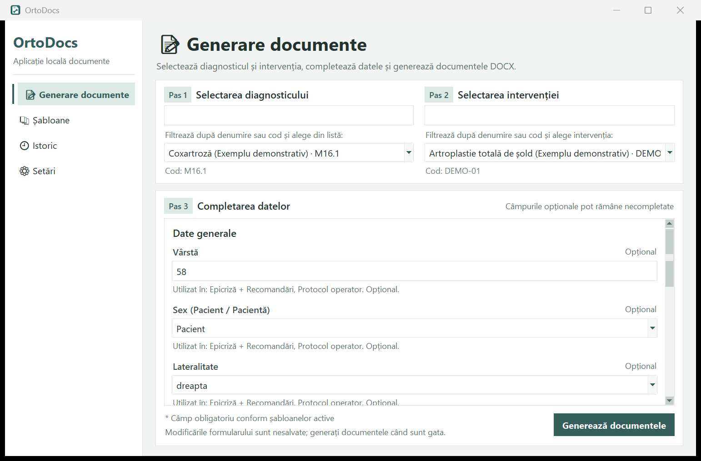
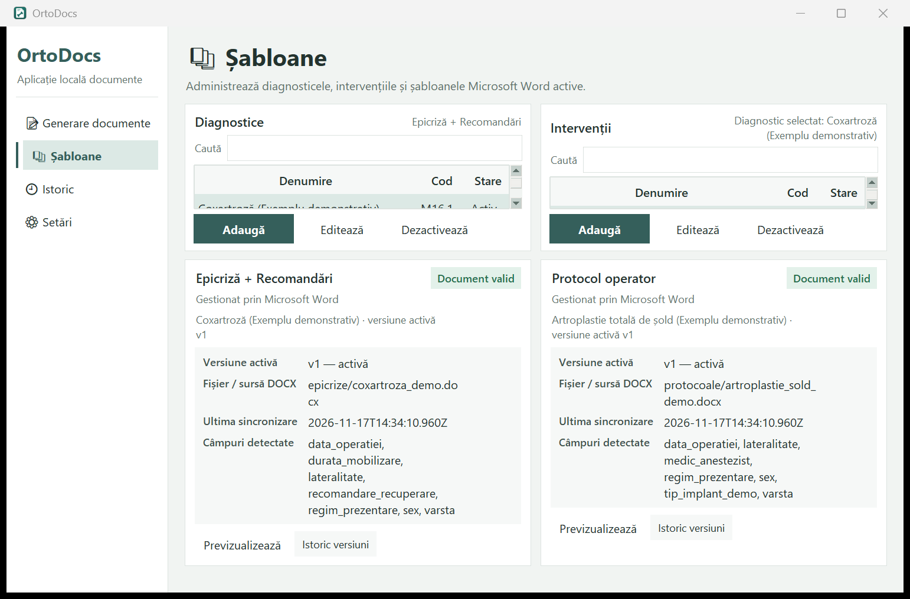
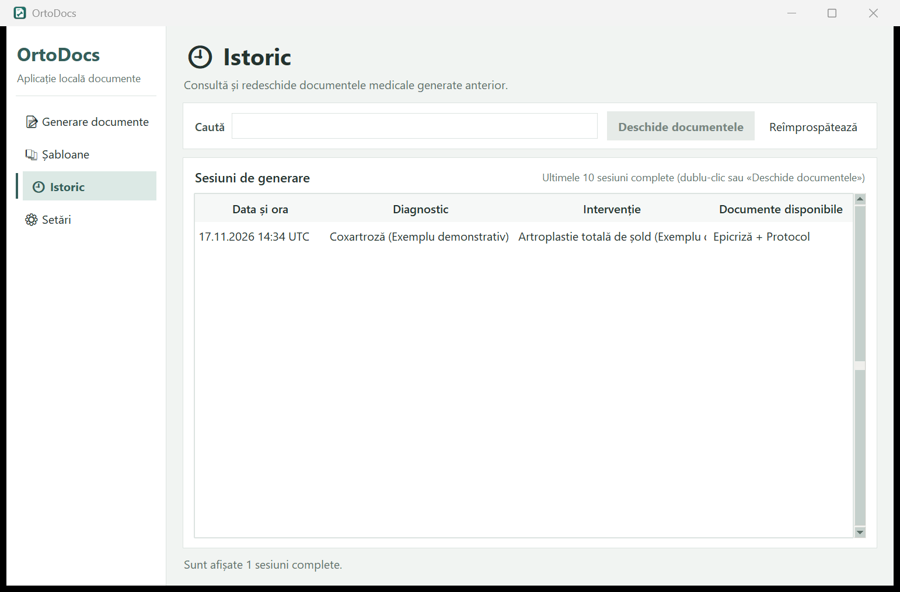
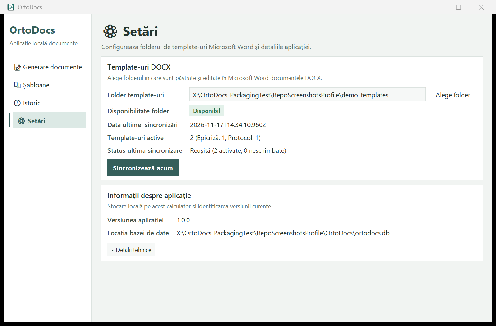

# OrtoDocs

Aplicație desktop offline pentru Windows, construită în Python și Tkinter/SQLite, destinată redactării și gestionării locale a documentelor medicale structurate (*Epicriză + Recomandări* și *Protocol operator*) pe baza unor șabloane Word (`.docx`) controlate.

> [!NOTE]
> **Statutul proiectului:** OrtoDocs este un proiect personal / de dezvoltare realizat pentru organizarea fluxului documentar. Aplicația **nu este validată clinic**, **nu este certificată ca dispozitiv medical** și **nu înlocuiește evaluarea sau decizia profesională**.
>
> **Date demonstrative:** Șabloanele din [`demo_templates/`](demo_templates/) și capturile de ecran de mai jos folosesc exclusiv conținut original și date complet fictive.

---

## Scopul aplicației

OrtoDocs oferă un flux unitar, complet local (fără servere externe și fără transmitere de date în rețea), prin care:

1. Șabloanele `.docx` editate offline sunt validate strict și sincronizate atomic într-o bază de date SQLite locală.
2. Utilizatorul selectează diagnosticul și intervenția, completează un formular dinamic generat automat din variabilele șabloanelor și obține simultan cele două documente formatate (*Epicriză + Recomandări* și *Protocol operator*).
3. Documentele generate pot fi editate în editorul Rich Text integrat, salvate și redeschise din istoricul local, iar conținutul formatat poate fi copiat în Word sau LibreOffice.

---

## Funcționalități principale

- **Generare documente în 3 pași:** căutare după denumire sau cod pentru diagnostic și intervenție, formular cu câmpuri standard și câmpuri dinamice detectate din șabloane, scroll cu mouse-ul/touchpad-ul și validare imediată.
- **Editor Rich Text integrat:** editare locală a documentelor generate (Bold, Italic, Subliniat, aliniere), salvare locală și copiere formatată a conținutului în Word sau LibreOffice.
- **Administrare și sincronizare offline a șabloanelor Word:** validare prin `catalog.json` + hash SHA-256, oprirea sincronizării la erori/avertismente (inclusiv blocarea token-urilor de identificare pacient în șabloane), backup automat înainte de aplicare și păstrarea istoricului versiunilor.
- **Istoric local:** consultarea și redeschiderea sesiunilor recente generate pe stația locală.
- **Stocare locală independentă:** datele utilizatorului (`%LOCALAPPDATA%\OrtoDocs\ortodocs.db`, backup-uri și șabloane sincronizate) rămân separate de directorul aplicației și supraviețuiesc upgrade-urilor sau dezinstalării.

---

## Capturi de ecran (profil demonstrativ cu date fictive)

| Generare documente | Șabloane și versiuni |
| :---: | :---: |
|  |  |
| **Istoric sesiuni** | **Setări și sincronizare** |
|  |  |

---

## Tehnologii folosite

- **Limbaj & UI:** Python 3.14, Tkinter / `ttk` (Tcl/Tk 9.0), temă dedicată Soft Medical cu suport Windows System DPI Awareness.
- **Bază de date:** SQLite local cu migrări versionate și backup automat înainte de modificări de schemă sau sincronizări.
- **Procesare documente:** `python-docx`, `lxml`, motor intern de parsare și substituție literală a variabilelor `{{cheie}}`.
- **Controale UI:** `tk-date-entry` (inclus cu textele de licență terțe aferente).
- **Packaging Windows (opțional):** PyInstaller (`onedir`) și Inno Setup 7 (script per-user în [`packaging/`](packaging/)).

---

## Structura proiectului

```text
OrtoDocs/
├── demo_templates/          # Catalog și șabloane DOCX demonstrative (date complet fictive)
│   ├── catalog.json
│   ├── epicrize/
│   └── protocoale/
├── docs/
│   ├── screenshots/         # Capturi de ecran pe profil demonstrativ izolat
│   └── template_sync/       # Specificația manifestului catalog.json și regulile de sincronizare
├── packaging/               # Configurație PyInstaller, script Inno Setup, iconiță și licențe terțe
├── src/
│   └── ortodocs/
│       ├── main.py          # Punct de intrare al aplicației și configurare DPI
│       ├── models/          # Modele de date (generare, documente Rich Text, rapoarte import)
│       ├── services/        # Import DOCX, substituție token-uri, sincronizare și generare documente
│       ├── storage/         # Conexiune SQLite, migrări și repository-uri
│       └── ui/              # Shell Tkinter, cele 4 pagini, editor Rich Text, clipboard Windows
├── tests/                   # Suită de teste automate (unittest)
├── pyproject.toml           # Metadate pachet și dependențe
└── README.md
```

---

## Pornire pentru dezvoltatori

### Cerințe

- Windows 10 / 11 (pentru suportul complet DPI și clipboard Windows)
- Python **3.14**

### Instalare și rulare în mediu virtual izolat

```powershell
# 1. Creare și activare mediu virtual
python -m venv .venv314
.\.venv314\Scripts\Activate.ps1

# 2. Instalare dependențe
pip install python-docx==1.2.0 lxml==6.1.3 tk-date-entry==1.1.0
```

### Pornirea aplicației cu un profil local izolat (recomandat la testare)

```powershell
$env:PYTHONPATH = "src"
$env:LOCALAPPDATA = "$PWD\build\dev-profile"
python -m ortodocs.main
```

Pentru a testa imediat fluxul complet fără date reale:
1. Deschide **Setări → Template-uri DOCX → Alege folder**.
2. Selectează folderul [`demo_templates/`](demo_templates/) din acest repository.
3. Confirmă sincronizarea, apoi revino în **Generare documente** pentru a completa formularul demonstrativ.

### Rularea suitei de teste

```powershell
$env:PYTHONPATH = "src"
$env:LOCALAPPDATA = "$PWD\build\isolated-localappdata"
python -m unittest discover -s tests -v
```
